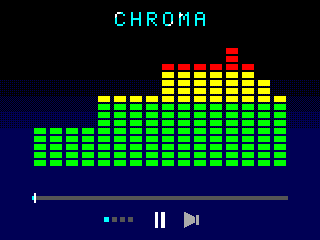
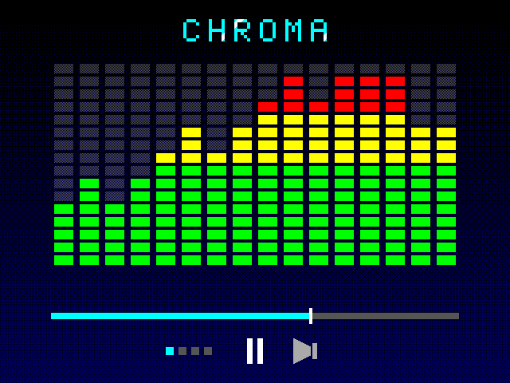
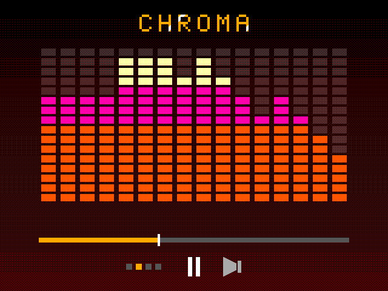
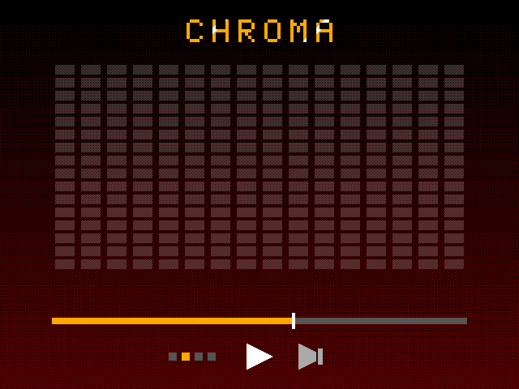

  

# CHROMA: a graphics + audio chip for a music player

CHROMA is a custom ASIC I'm designing for [Tiny Tapeout](https://tinytapeout.com) (SkyWater 130 nm). It is the heart of a handheld music player. The one chip both **generates the music** and **renders the player's UI** to a VGA display, with no CPU and no framebuffer.



| Playing | Next track (new theme) | Paused |
|---|---|---|
|  |  |  |

These images are reconstructed **only from the chip's output pins** (hsync, vsync, RGB) by a simulated VGA monitor. Audio from the same simulation: [`media/chroma_audio.wav`](media/chroma_audio.wav).

## Architecture

```
            ui[0] PAUSE   ui[1] NEXT
                 │            │  (sampled once per frame = debounced)
                 ▼            ▼
 ┌──────────── sequencer (60 Hz frame tick) ────────────┐
 │ step counter ─► melody ROM (32 x 6b) ─► note latch   │
 │                 track select: octave / reverse       │
 │ envelope (4b, decays per frame)   LFSR jitter        │
 └───────┬──────────────────┬──────────────────┬────────┘
         │ note             │ env              │ step, env, note
         ▼                  ▼                  ▼
 ┌─ synthesizer ──────────────┐   ┌─ pixel pipeline (per clock) ─────────┐
 │ period LUT + octave shift  │   │ hvsync generator (640x480 @ 60 Hz)   │
 │ 16b oscillator ─► square   │   │ title font ROM · 16x16 visualizer    │
 │ PWM volume (duty = env)    │   │ progress bar · icons · dither bg     │
 └──────────┬─────────────────┘   │ layer priority mux ─► output reg     │
            ▼                     └───────────────┬──────────────────────┘
       uio[7] AUDIO                       uo[7:0] TinyVGA (RGB222 + sync)
```

Key design choices:

- **Racing the beam.** A 640x480 framebuffer would need ~1.8 Mbit of memory, which is far bigger than the whole chip. Instead, every pixel is a pure function of `(x, y, state)`, evaluated in the 40 ns each pixel is on screen.
- **Power-of-two layout.** Bar, segment and glyph positions are chosen so that "which bar am I in?" is a bit-slice of the coordinate rather than a divider.
- **Registered outputs.** The final pixel is registered so it lines up with the (registered) sync signals and the pins never glitch.
- **One clock domain.** All animation advances on a one-cycle `frame_tick` enable. Nothing is clocked from a data signal.

Size: ~1,400 logic gates and 94 flip-flops (generic Yosys synthesis), targeting 1x2 Tiny Tapeout tiles.

## Verification

`sim/` contains a cycle-accurate testbench. Yosys compiles the Verilog to C++ (CXXRTL), and the testbench acts as a VGA monitor:

| Check (10 s of simulated time, 252 M clock cycles) | Result |
|---|---|
| hsync period = 800 clocks, width = 96 | 0 errors |
| vsync period = 525 lines, width = 2 | 0 errors |
| no color output during blanking | 0 errors |
| note pitches (A4/C5/E5, A5 on the octave-up track) | 438/525/663/871 Hz vs. 440/523/659/880 Hz (measured by counting zero crossings) |
| audio silent when paused | RMS = 0 |

`test/` contains cocotb tests that run on both the RTL and the post-layout gate-level netlist in CI.

```
pip install yowasp-yosys pillow
python sim/run_sim.py          # needs g++; writes media/*.png, *.gif, *.wav
```

## Roadmap

- [x] RTL: video timing, UI renderer, sequencer, synthesizer
- [x] Cycle-accurate simulation + automated timing/audio checks
- [ ] GDS (chip layout) via the Tiny Tapeout GitHub Action
- [ ] FPGA prototype driving a real VGA monitor + speaker
- [ ] Handheld music-player PCB (KiCad) built around the chip
- [ ] Tape out on a Tiny Tapeout shuttle, then bring up the silicon
- [ ] v2: sprite engine / tiny SIMD multiply-accumulate unit (GPU/AI-accelerator building block)
