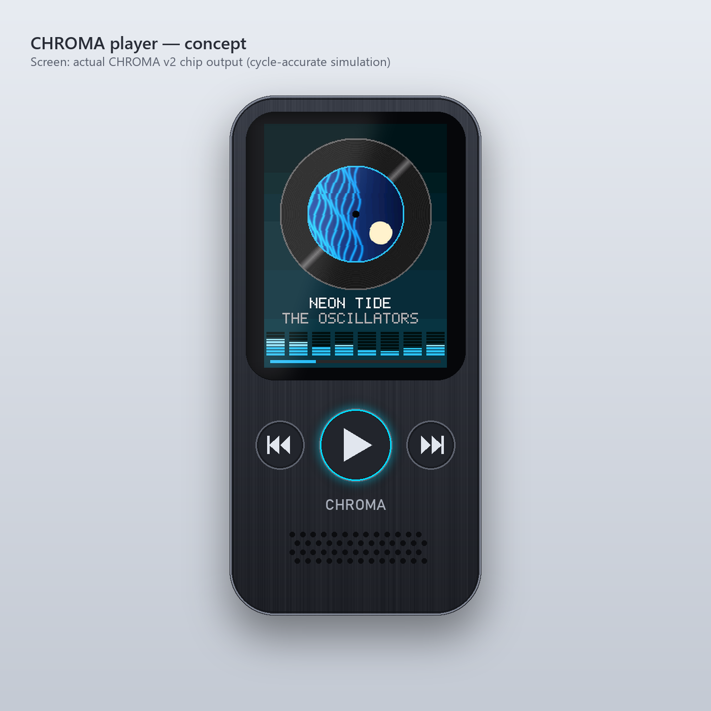
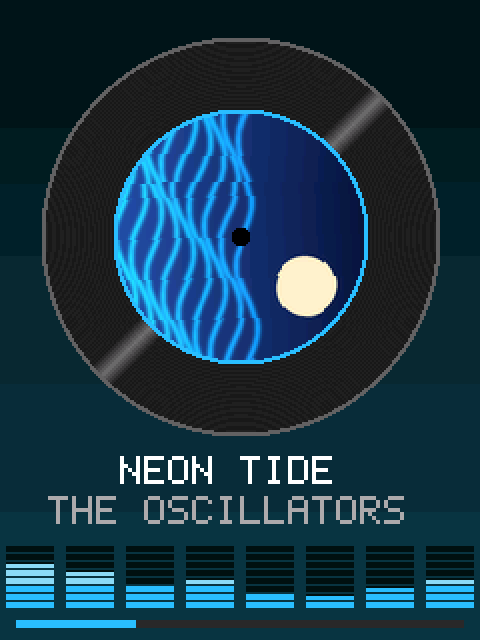
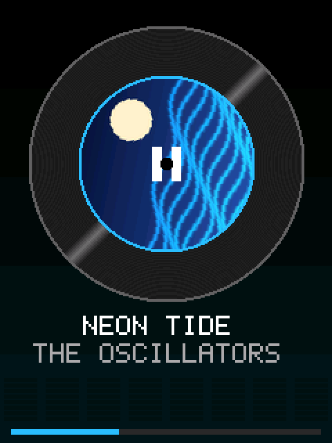
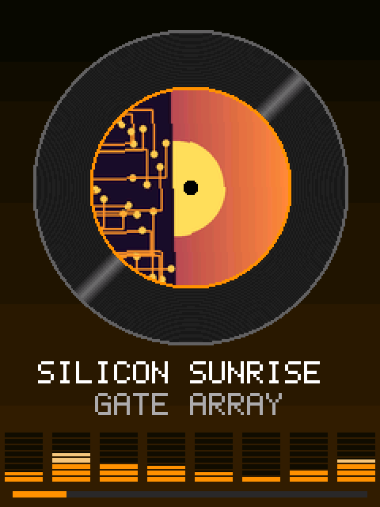

# CHROMA v2: display + audio-visualiser chip for a Spotify player



CHROMA v2 is the custom chip inside a pocket music player. A Raspberry Pi Zero 2 W handles Wi-Fi and Spotify, which needs Premium and the open-source librespot client. The Pi sends the song's text and cover art to CHROMA over SPI, and a copy of the audio over I2S. CHROMA renders the whole "now playing" screen on its own:

- **Spinning vinyl record.** The album cover is texture-mapped and rotated in real time. Texels are fetched from an external 8 MB QSPI PSRAM, using an incremental DDA that needs two adds per pixel and no multipliers.
- **Title and artist text** from an on-chip 5x7 font ROM.
- **8-band hardware spectrum analyser.** Eight state-variable band-pass filters at Q = 4 share **one** serial shift-and-add multiplier, with a log-scale peak meter at 3 dB per step and falling bars.
- **Beat-reactive** background, progress bar and pause icon.
- **Output:** a 240x320 LCD (ST7789 class) over an 8-bit 8080 bus, with no framebuffer on chip.

| Playing | Paused | Next track |
|---|---|---|
|  |  |  |

These images are cycle-accurate simulation output. They're read back from the LCD model's frame memory, which only the chip's 8-bit bus can write to.

## Block diagram

```
 Pi ──SPI──► spi_slave ─► command decoder ─► text buffer, state, accent colour
                                     └─ cover pixels ─► psram_qpi ◄──► PSRAM (QPI, 4-bit)
 Pi ──I2S──► audio_bands: I2S rx → 8 x SVF (1 shared multiplier) → peaks → levels
                                                                        │
 renderer: LCD init → per frame: CASET/RASET/RAMWR → 76,800 pixels ◄────┘
   per pixel: r² (incremental) → disc / label / text / bars / progress / background
              label pixels: texture DDA (u += cos, v -= sin) → PSRAM read → texel
   └──► 8-bit 8080 bus ──► LCD (ST7789 class)
```

## Pinout (Tiny Tapeout style)

| Pin | Function |
|---|---|
| `ui[0..2]` | SPI SCK, MOSI, CS_N (from the Pi) |
| `ui[3..5]` | I2S BCLK, LRCLK, DIN (from the Pi) |
| `uo[7:0]` | LCD D[7:0] |
| `uio[0..1]` | LCD WR_N, DC |
| `uio[2..3]` | PSRAM CS_N, SCK |
| `uio[7:4]` | PSRAM IO[3:0] (bidirectional) |

## SPI command set

| Byte 0 | Payload |
|---|---|
| `0x01` STATE | flags (bit 0 = playing), progress 0–255, accent colour RGB565 (2 bytes) |
| `0x02` TEXT | line (0 = title, 1 = artist), then 18 x 6-bit character codes |
| `0x03` COVER | 128x128 RGB565, big-endian, row-major (32,768 bytes) |

## Verification

`sim/tb_v2.cpp` models every chip around CHROMA at the pin level:

- **LCD:** an ST7789-style command decoder and frame memory, with write-timing checks.
- **PSRAM:** an APS6404-style QPI model with bus-contention and CE#-low-time checks.
- **Pi:** an SPI master on a schedule, plus an I2S transmitter.

Checks from the latest run:

| Check | Result |
|---|---|
| Cover on screen vs. uploaded cover (record not yet spinning) | 11,648 / 11,648 pixels identical |
| Tone test: 60 Hz … 8 kHz | each tone lights its own band (8 / 8) |
| Spectrum bars vs. a bit-exact Python model of the filter bank | 93% of frames identical, 97% within one level |
| LCD protocol errors / WR timing | 0 errors; WR low 40 ns, cycle 80 ns (ST7789 needs ≥ 15 / 66 ns) |
| PSRAM protocol errors / bus contention | 0 / 0; CE# low ≤ 740 ns (limit 8 µs) |
| Frame rate with the record spinning | ~47 fps (81 fps without cover art) |

```
pip install yowasp-yosys pillow numpy
python sim/run_v2.py           # needs g++; ~15 min: build, 8 s demo, tone test, checks
python sim/model_bands.py      # compare the drawn bars with the bit-exact model
python product/render_product.py
python video/make_v2_video.py  # needs ffmpeg + Windows voices
```

## Size

Generic synthesis gives about 9,600 gates and 1,700 flip-flops. Scaled from v1's real sky130 layout, that's roughly 89k µm², or about **8–12 Tiny Tapeout tiles**, most likely a 6x2 slot. The flip-flops dominate: the filter state is 8 bands x 2 x 26 bits, plus the peaks and the text buffer.

## Known limits / next steps

- **Timing closure at 50 MHz** hasn't been checked. There's no place-and-route of v2 yet, and the per-pixel colour logic is a long combinational path that may need a pipeline stage.
- **PSRAM read capture.** Read data is sampled half an SCK period (20 ns) after the memory starts driving it. With Tiny Tapeout's I/O pad delays that may be marginal, so add a configurable capture delay before tape-out.
- **Area.** The filter state and text buffer could shrink: 20-bit states, or keeping the text in PSRAM.
- **FPGA bring-up next:** a real ST7789 parallel LCD, an APS6404 PSRAM and a Pi running librespot.

All test content (covers, music, song names) is original and generated by `sim/gen_assets.py`.
